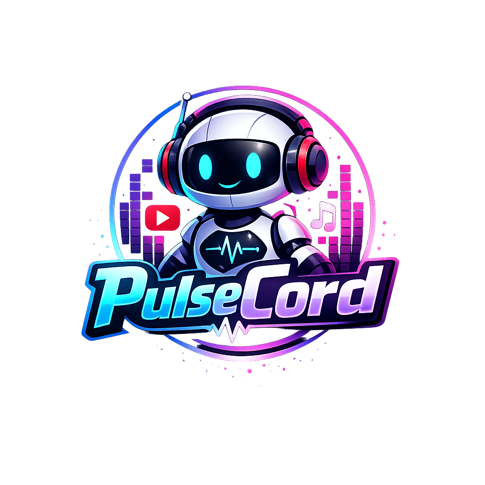

<p align="center">
  
</p>

# PulseCord

A self-hostable Discord bot that plays YouTube audio in voice channels. Post a YouTube link (or use `!play`) and the bot joins your voice channel and streams the audio.

Because the code is open source and self-hosted, anyone can run their own instance — no single bot to shut down.

---

## Commands

| Command | Description |
|---|---|
| `!play <youtube-url>` | Joins your voice channel and plays the video's audio |
| A bare YouTube URL | Same as `!play` — just paste the link |
| `!stop` | Stops playback and disconnects the bot |

---

## Prerequisites

Install these before anything else.

### 1. Node.js (v16 or later)
Download from [nodejs.org](https://nodejs.org).

Verify: `node --version`

### 2. yt-dlp
The bot uses `yt-dlp` to stream YouTube audio. It must be installed and available on your system PATH.

**Windows:**
```
winget install yt-dlp.yt-dlp
```

**macOS:**
```
brew install yt-dlp
```

**Linux:**
```
sudo pip install yt-dlp
```

Verify: `yt-dlp --version`

> Restart your terminal after installing so the PATH is updated.

### 3. ffmpeg
Used to transcode the audio stream.

**Windows:**
```
winget install Gyan.FFmpeg
```

**macOS:**
```
brew install ffmpeg
```

**Linux:**
```
sudo apt install ffmpeg
```

Verify: `ffmpeg -version`

---

## Setting Up a Discord Bot

### 1. Create the application
1. Go to the [Discord Developer Portal](https://discord.com/developers/applications)
2. Click **New Application** and give it a name
3. Go to the **Bot** tab in the left sidebar
4. Click **Add Bot**
5. Under **Token**, click **Reset Token** and copy the token — you'll need this later

### 2. Enable privileged intents
Still on the **Bot** tab, scroll down to **Privileged Gateway Intents** and enable:
- **Server Members Intent**
- **Message Content Intent**

Click **Save Changes**.

### 3. Invite the bot to your server
1. Go to the **OAuth2 → URL Generator** tab
2. Under **Scopes**, check `bot`
3. Under **Bot Permissions**, check:
   - Read Messages / View Channels
   - Send Messages
   - Connect
   - Speak
4. Copy the generated URL at the bottom and open it in your browser to invite the bot to your server

---

## Installation

```bash
git clone https://github.com/ashindlecker/PulseCord.git
cd discord-music-bot
npm install
```

Copy the example environment file and add your bot token:

```bash
cp .env.example .env
```

Open `.env` and replace the placeholder with your token from the Developer Portal:

```
DISCORD_TOKEN=your_bot_token_here
```

---

## Running the Bot

**Development** (runs directly with ts-node, no build step):
```bash
npm run dev
```

**Production** (compile first, then run):
```bash
npm run build
npm start
```

You should see `Bot ready: YourBotName#1234` in the console when it connects successfully.

---

## Dependencies

| Package | Purpose |
|---|---|
| `discord.js` | Discord API client |
| `@discordjs/voice` | Voice channel connections and audio playback |
| `@discordjs/opus` | Opus audio codec |
| `ffmpeg-static` | Bundled ffmpeg fallback for audio transcoding |
| `dotenv` | Loads the bot token from `.env` |
| `yt-dlp` *(system)* | Streams YouTube audio — must be installed separately |

---

## License

MIT
